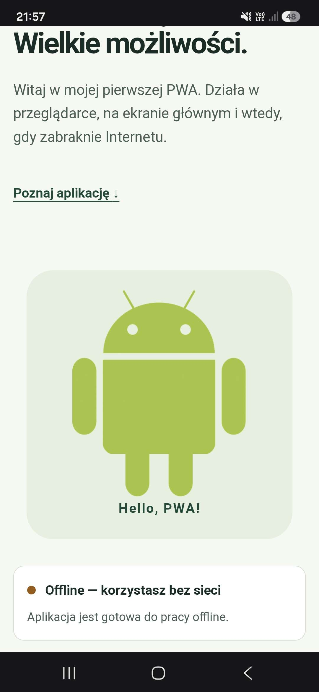

# Lab 1
**Opublikowany adres HTTPS:** https://ztam-lab01.web.app/.

## Uruchomienie

W folderze `lab_01`:

```bash
npm start
```

Otwórz `http://localhost:3000`.

## Zdjęcie



## Zawartość

| Plik / folder | Rola | 
| --- | --- |
| `public/index.html`, `styles.css`, `index.js` | Responsywna strona, status sieci, rejestracja SW i przycisk instalacji |
| `public/manifest.json` | Nazwa, kolory, względny zakres, tryb standalone i ikony |
| `public/icons/`, `public/android.png` | Ikony 192 i 512 px, warianty maskable, favicon i grafika |
| `public/service-worker.js` | Precache, NetworkFirst dla dodatkowych stron, CacheFirst dla obrazów, własny fallback |
| `public/precache-manifest.js` | Wygenerowana lista plików z revision opartym o SHA-256 |
| `public/offline.html`, `404.html` | Oddzielne widoki braku sieci oraz nieznanego adresu online |
| `public/vendor/workbox/` | Lokalne, oficjalne moduły Workbox wraz z licencjami MIT |
| `public/android.png` | Oryginalna grafika z laboratorium, źródło ikon generowanych z zachowaniem proporcji |
| `scripts/` | Serwer lokalny, generatory zasobów oraz audyt Lighthouse |
| `firebase.json` | Gotowa konfiguracja hostingu bez przepisywania wszystkich URL na index.html |
