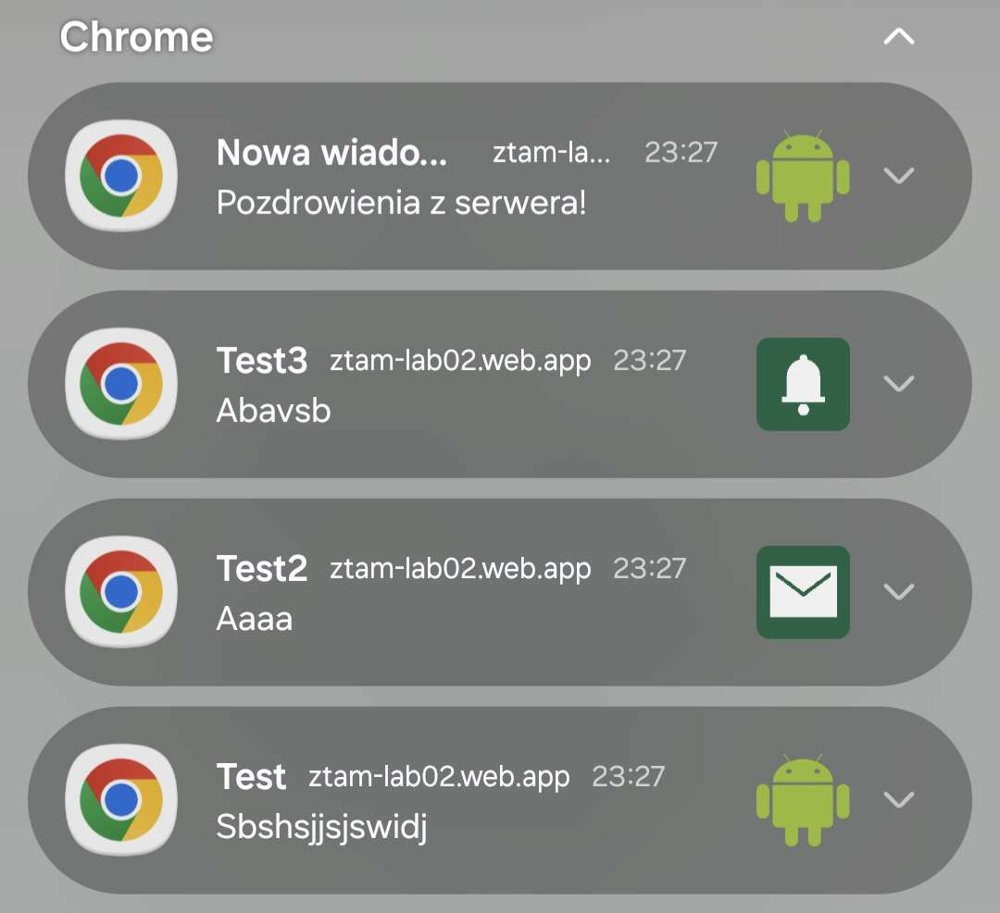
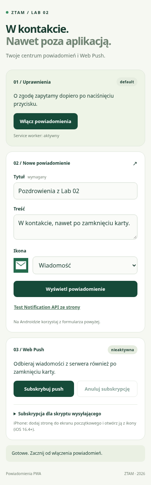

# Lab 2

**Opublikowany adres HTTPS:** https://ztam-lab02.web.app/.

## Uruchomienie

W folderze `lab_02`:

```bash
npm ci
npm start
```

Otwórz `http://localhost:3002`.

## Web Push

Klucze dla opublikowanej aplikacji są już wygenerowane lokalnie. Włącz powiadomienia, subskrybuj push i pobierz subskrypcję jako `lab_02/subscription.json`, następnie:

```bash
npm run push -- "Nowa wiadomość" "Pozdrowienia z serwera!"
```

Po sklonowaniu repozytorium uruchom `npm run keys` i opublikuj własną wersję (`npm run deploy` wymaga dostępu do projektu `ztam-lab02`). Nowe klucze wymagają nowych subskrypcji. Klucz prywatny oraz subskrypcja są poza folderem `public` i wykluczone z Gita.

## Zdjęcia
### Powiadomienia



### Widok mobile


## Zawartość

| Plik / folder | Rola |
| --- | --- |
| `public/index.html`, `public/styles.css` | Responsywna strona z formularzem powiadomień i sekcją Web Push |
| `public/notification.js` | Uprawnienia, walidacja formularza, wysyłanie powiadomień oraz obsługa subskrypcji push |
| `public/service-worker.js` | Odbiór push i przywoływanie lub otwieranie aplikacji po kliknięciu powiadomienia |
| `public/manifest.json` | Nazwa aplikacji, kolory, zakres, tryb standalone i ikony PWA |
| `public/icons/`, `public/android.png` | Ikony aplikacji oraz trzy obrazki do wyboru w formularzu powiadomień |
| `public/vapid-public-key.js` | Publiczny klucz VAPID używany przy subskrybowaniu push |
| `generate-keys.mjs` | Generowanie pary kluczy VAPID i zapis klucza publicznego w folderze `public` |
| `send-push.mjs` | Wysyłanie powiadomień Web Push z terminala |
| `scripts/server.mjs` | Lokalny serwer plików aplikacji |
| `tests/service-worker.test.mjs` | Testy obsługi wiadomości push i kliknięć w powiadomienia |
| `package.json`, `package-lock.json` | Polecenia npm oraz zależności projektu |
| `firebase.json` | Konfiguracja publikacji folderu `public` w Firebase Hosting |
| `.gitignore` | Wykluczenie klucza prywatnego, subskrypcji i plików roboczych z repozytorium |
| `mobile_screen.png` | Zrzut aplikacji w widoku mobilnym |
| `TODO.md` | Zadania wymagające dokończenia wraz z instrukcjami krok po kroku |
