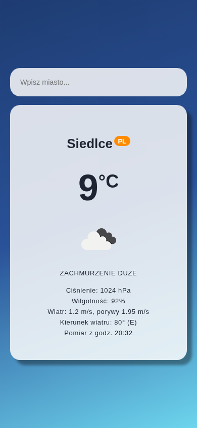
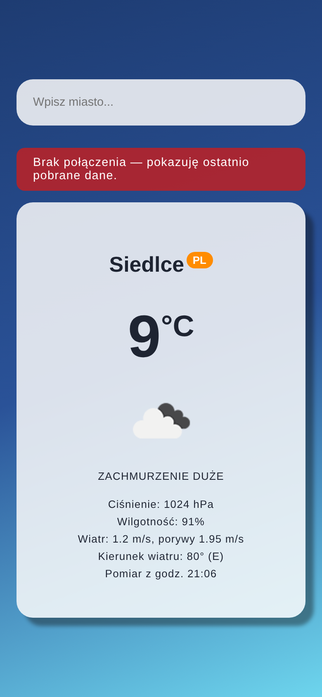

# Lab 3

## Uruchomienie

W folderze `lab_03` utwórz plik `.env` z kluczem OpenWeatherMap:

```bash
WEATHER_KEY=twój_klucz_api
```

Następnie:

```bash
npm install
npm run build
npm run dev
```

Otwórz `http://localhost:4173`.

## Klucz API

Aplikacja wysyła zapytania do `/api/weather`, a serwer Vite przekazuje je do OpenWeatherMap, dopisując klucz z `.env`. Klucz nie trafia do kodu aplikacji, folderu `dist`, ani żądań HTTP klienta.

## Zdjęcia
### Pogoda dla wybranego miasta



### Tryb offline



## Zawartość

| Plik / folder | Rola |
| --- | --- |
| `src/App.jsx` | Wyszukiwanie miasta, karta pogody (temperatura, ikona, opis, ciśnienie, wilgotność, wiatr, godzina pomiaru) i komunikat o braku sieci |
| `src/api/fetchWeather.js` | Zapytanie do `/api/weather` i obsługa błędów (nieznane miasto, brak sieci, zły klucz) |
| `src/App.css` | Style z materiałów do zajęć |
| `vite.config.js` | Proxy z kluczem API, manifest PWA oraz cache NetworkFirst dla API i CacheFirst dla ikon pogody |
| `public/` | Ikony PWA wygenerowane z logo Vite |
