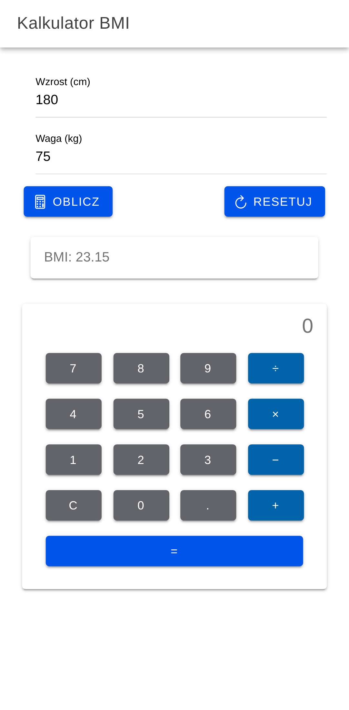
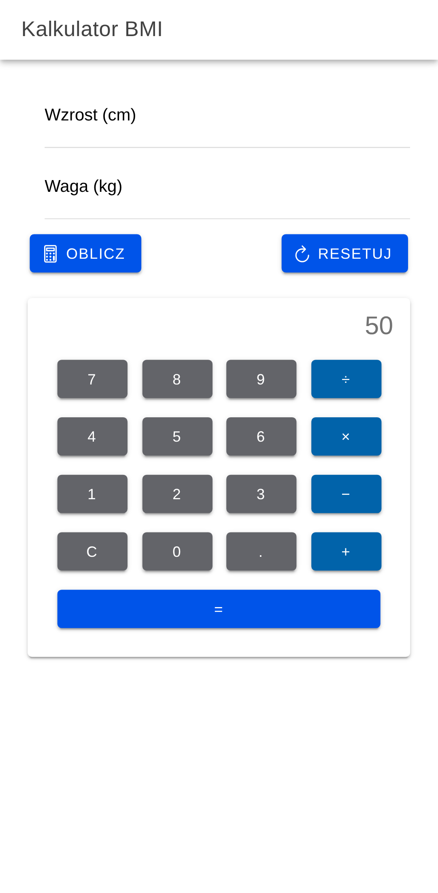

# Lab 4

## Uruchomienie

W folderze `lab_04`:

```bash
npm install
ionic serve
```

Otwórz `http://localhost:8100`.

## Zdjęcia
### Kalkulator BMI



### Kalkulator



## Zawartość

| Plik / folder | Rola |
| --- | --- |
| `src/App.tsx` | Kalkulator BMI z polami wzrostu i wagi, przyciskami oraz kartą z wynikiem |
| `src/components/Kalkulator.tsx` | Kalkulator czterech działań jako osobny komponent |
| `src/main.tsx` | Uruchomienie komponentu `App` |
| `src/theme/variables.css` | Zmienne motywu Ionic |
| `public/` | Ikona i manifest aplikacji |
| `index.html` | Strona startowa aplikacji |
| `package.json`, `package-lock.json` | Polecenia npm oraz zależności projektu |
| `capacitor.config.ts`, `ionic.config.json` | Konfiguracja Capacitor i Ionic CLI |
| `vite.config.ts`, `tsconfig.json`, `tsconfig.node.json` | Konfiguracja budowania i TypeScript |
| `.gitignore` | Wykluczenie zależności, plików budowania i testów z szablonu |
