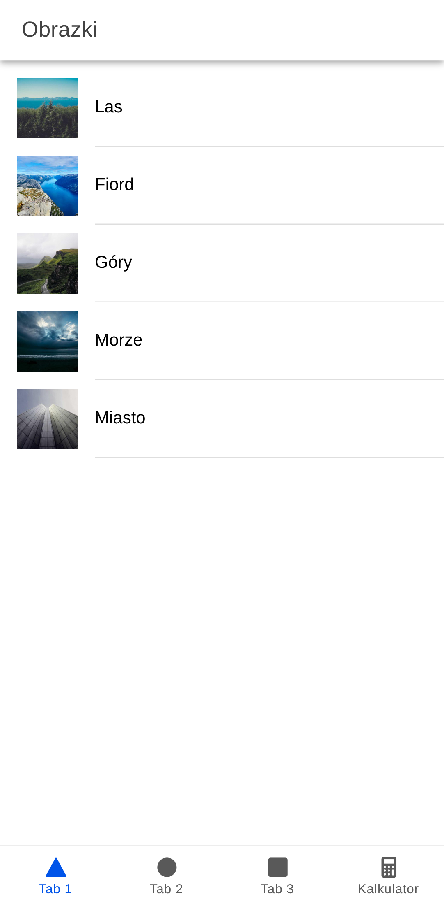
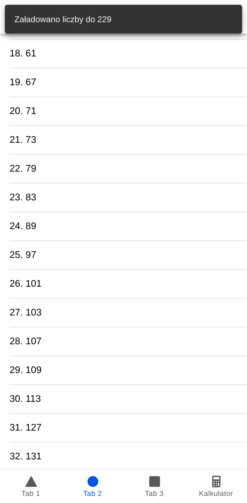
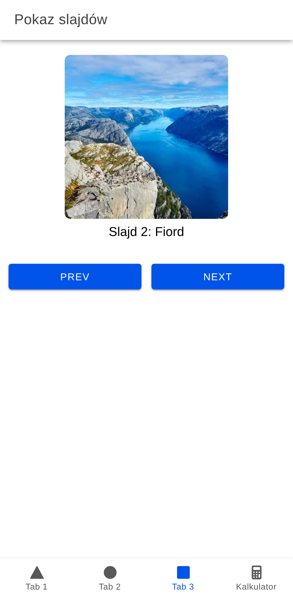
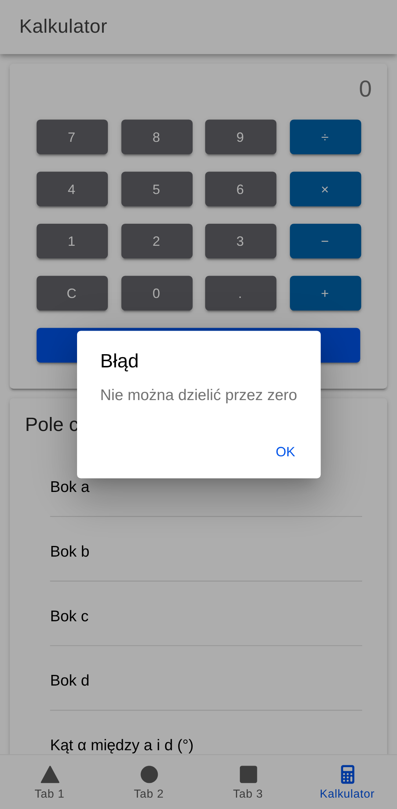
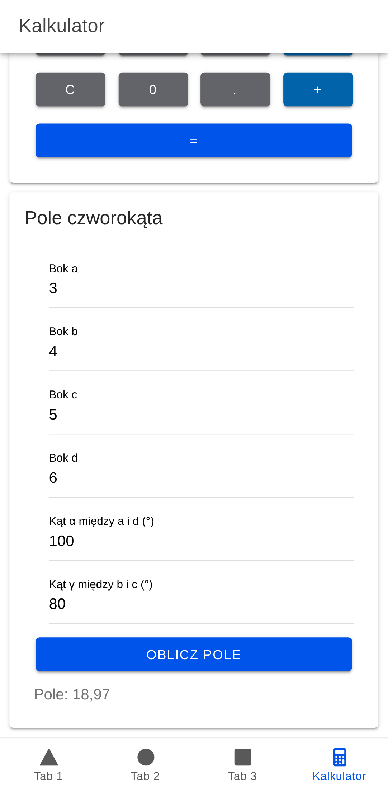

# Lab 5

## Uruchomienie

W folderze `lab_05`:

```bash
npm install
ionic serve
```

Otwórz `http://localhost:8100`.

## Zdjęcia
### Lista obrazków



### Liczby pierwsze



### Pokaz slajdów



### Kalkulator



### Pole czworokąta



## Zawartość

| Plik / folder | Rola |
| --- | --- |
| `src/App.tsx` | Trasy i pasek czterech zakładek |
| `src/pages/Tab1.tsx` | Lista obrazków z miniaturami budowana z tablicy danych |
| `src/pages/Tab2.tsx` | Lista liczb pierwszych z przewijaniem bez końca i komunikatem toast |
| `src/pages/Tab3.tsx` | Pokaz slajdów Swiper z przyciskami PREV i NEXT |
| `src/pages/Tab4.tsx` | Zakładka z kalkulatorem i polem czworokąta |
| `src/components/Kalkulator.tsx` | Kalkulator czterech działań z alertem dzielenia przez zero |
| `src/components/PoleCzworokata.tsx` | Formularz liczący pole czworokąta wzorem Bretschneidera |
| `src/main.tsx` | Uruchomienie komponentu `App` |
| `src/theme/variables.css` | Zmienne motywu Ionic |
| `public/` | Ikona, manifest aplikacji i obrazki w `public/img` |
| `index.html` | Strona startowa aplikacji |
| `package.json`, `package-lock.json` | Polecenia npm oraz zależności projektu |
| `capacitor.config.ts`, `ionic.config.json` | Konfiguracja Capacitor i Ionic CLI |
| `vite.config.ts`, `tsconfig.json`, `tsconfig.node.json` | Konfiguracja budowania i TypeScript |
