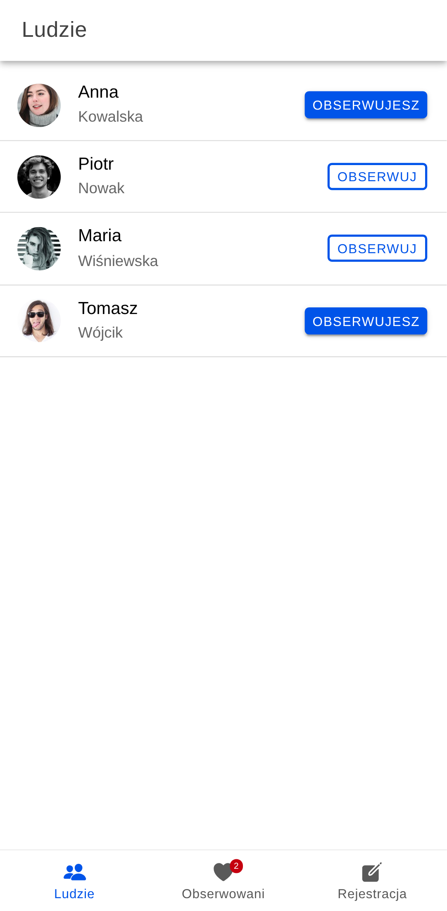
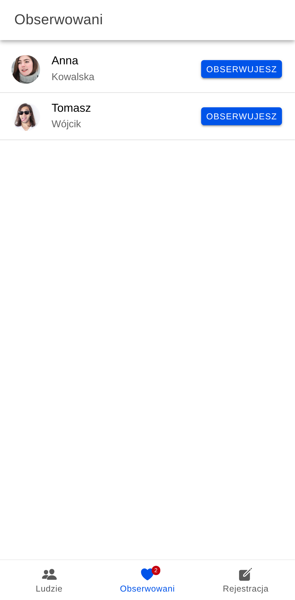
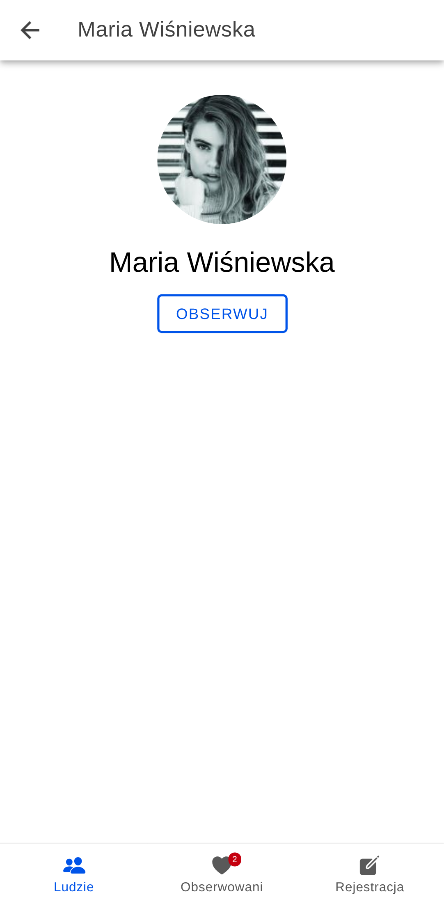
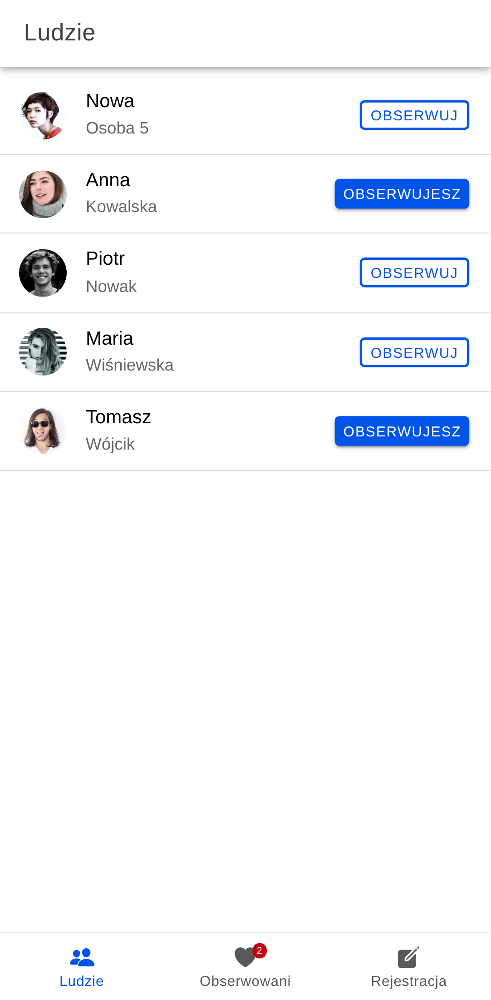
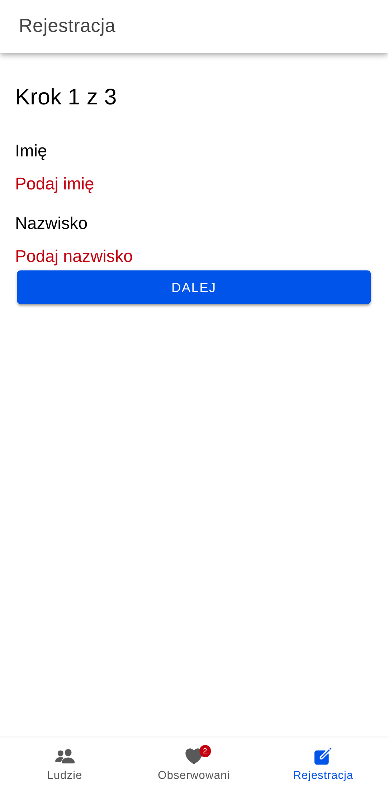
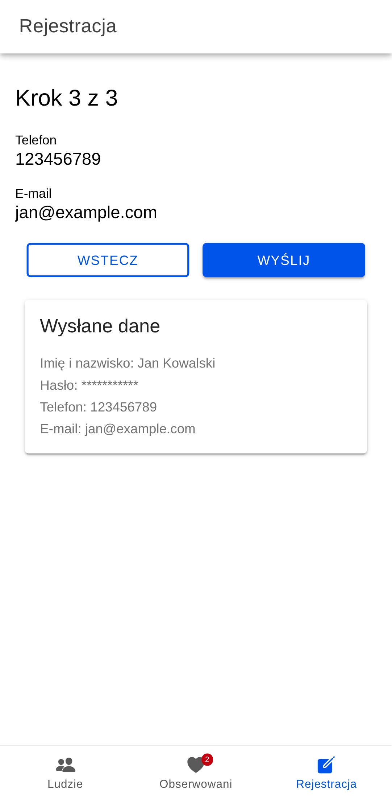

# Lab 6

## Uruchomienie

W folderze `lab_06`:

```bash
npm install
ionic serve
```

Otwórz `http://localhost:8100`.

## Zdjęcia
### Lista osób



### Obserwowani



### Szczegóły osoby



### Lista po odświeżeniu



### Formularz z błędami



### Wysłane dane



## Zawartość

| Plik / folder | Rola |
| --- | --- |
| `src/App.tsx` | Trasy, pasek trzech zakładek i licznik obserwowanych osób |
| `src/data/people.ts` | Typ osoby i dane startowe |
| `src/store/peopleStore.ts` | Wspólny stan aplikacji w bibliotece Zustand |
| `src/components/PersonItem.tsx` | Element listy z przyciskiem Obserwuj i linkiem do szczegółów |
| `src/pages/Tab1.tsx` | Lista osób z odświeżaniem przeciągnięciem w dół |
| `src/pages/Tab2.tsx` | Lista obserwowanych osób |
| `src/pages/Tab3.tsx` | Formularz krokowy z walidacją react-hook-form na slajdach Swiper |
| `src/pages/PersonDetail.tsx` | Widok szczegółów osoby z parametrem w adresie |
| `src/main.tsx` | Uruchomienie komponentu `App` |
| `src/theme/variables.css` | Zmienne motywu Ionic |
| `public/` | Ikona i manifest aplikacji |
| `index.html` | Strona startowa aplikacji |
| `package.json`, `package-lock.json` | Polecenia npm oraz zależności projektu |
| `capacitor.config.ts`, `ionic.config.json` | Konfiguracja Capacitor i Ionic CLI |
| `vite.config.ts`, `tsconfig.json`, `tsconfig.node.json` | Konfiguracja budowania i TypeScript |
